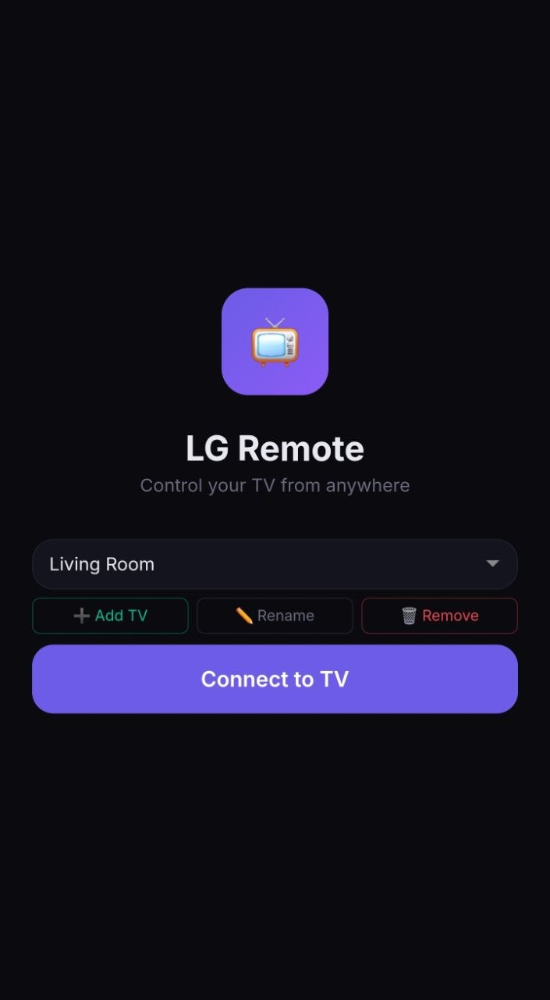
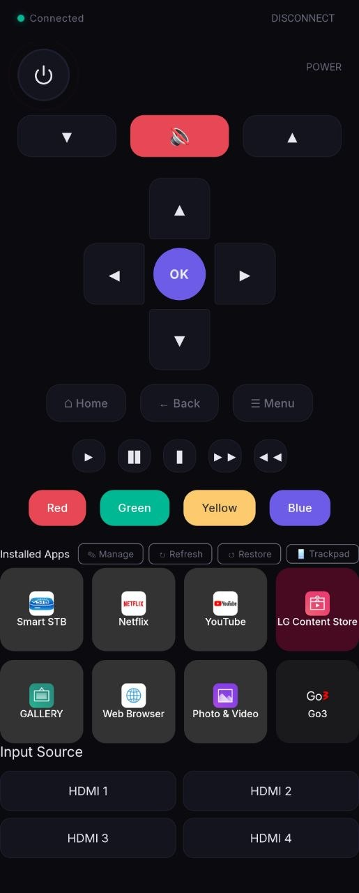

# LG TV Remote Control - BETA

A lightweight, mobile-friendly web remote control for LG Smart TVs running WebOS, built with Node.js and deployed via Docker Compose.
Tested on  2019 LG C9 with latest WebOS. Some functions might still not work. 

## Table of Contents

- [Architecture](#architecture)
- [Features](#features)
- [Getting Started](#getting-started)
  - [1. Prerequisites](#1.-prerequisites)
  - [2. Configuration](#2.-configuration)
  - [3. Start](#3.-start)
  - [4. Pairing](#4.-pairing)
- [API Endpoints](#api-endpoints)
  - [App IDs](#app-ids)
- [Protocol](#protocol)
- [Troubleshooting](#troubleshooting)
  - ["Too many pairing requests"](#"too-many-pairing-requests")
  - [Buttons not responding](#buttons-not-responding)
  - [Connection drops](#connection-drops)
- [Project Structure](#project-structure)
- [Screenshots](#screenshots)
  - [Front Welcome Screen](#front-welcome-screen)
  - [Mobile Remote Control](#mobile-remote-control)
- [License](#license)

## Architecture

```
┌─────────────────┐         ┌──────────────────┐         ┌────────────┐
│  Mobile Browser │───────▶│   Nginx (UI)     │────────▶│   TV       │
│  (port 5203)    │  HTTP   │  (port 8080)     │  WS     │ (port 3001)│
└─────────────────┘         │                  │◀───────│             │
                            │  /api/ proxy     │  JSON   │ WebOS SSAP │
                            └──────────────────┘         └────────────┘
                                       │
                                       ▼
                              ┌──────────────────┐
                              │  Node.js API     │
                              │  (port 3000)     │
                              └──────────────────┘
```

The UI is a static React single-page app served by Nginx. All communication with the TV goes through the Node.js API backend, which manages WebSocket connections to the TV's SSAP (Smart Support API Platform) interface.

## Features

- **Auto-pairing** — Reuses saved credentials on restart; no need to approve the TV prompt after initial pairing.
- **TV Profiles** — Save multiple TVs with custom names. Reconnect instantly from the dropdown.
- **App Discovery** — Lists all installed apps from the TV with icons, colors, and drag-and-drop reorder.
- **Navigation** — D-pad, Home, Back, Enter, Menu, Guide buttons.
- **Volume & Mute** — Up, down, and toggle mute.
- **Air Mouse Trackpad** — Swipe on the phone screen to move the cursor on the TV. Tap to click. Full-screen overlay prevents accidental button presses.
- **Input switching** — Launch HDMI 1–4, YouTube, Netflix, and any other installed app by ID.
- **Power** — Turn the TV on/off (when supported by the firmware).
- **Mobile-first UI** — Responsive dark-themed layout designed for phone screens.

## Getting Started

### 1. Prerequisites

- [Docker](https://www.docker.com/) and [Docker Compose](https://docs.docker.com/compose/)
- An LG Smart TV on the same local network

### 2. Configuration

Edit `docker-compose.yml` if you need to change the host ports (defaults are 5203 for the UI and 5204 for the API).

### 3. Start

```bash
docker compose up -d --build
```

The UI will be available at `http://<your-host-ip>:5203`.

### 4. Pairing

1. Open the UI on your phone or browser.
2. Enter your TV's IP address (e.g. `192.168.1.21`).
3. Click **Connect**. A pairing prompt will appear on the TV screen — press **Allow**.
4. The client-key is automatically saved to a Docker volume. Subsequent connections use it for auto-pairing without prompting, unless the TV is powered off or the saved key is cleared.

> **Tip:** If the TV rejects the connection ("too many pairing requests"), power cycle the TV and wait 30 seconds before reconnecting.

## API Endpoints

| Method | Endpoint | Description |
|--------|----------|-------------|
| `POST` | `/api/connect` | Connect to TV (body: `{ "ip": "..." }`) |
| `GET`  | `/api/status` | Connection status (query: `?ip=...`) |
| `POST` | `/api/disconnect` | Disconnect from TV |
| `POST` | `/api/button` | Send button press — body: `{ "ip": "...", "action": "Home" }` |
| `POST` | `/api/volume` | Volume control — body: `{ "ip": "...", "action": "up\|down\|mute" }` |
| `POST` | `/api/volume/set` | Set volume level — body: `{ "ip": "...", "volume": 30 }` |
| `POST` | `/api/mute` / `/api/unmute` | Toggle mute |
| `POST` | `/api/launch` | Launch an app — body: `{ "ip": "...", "appId": "youtube" }` |
| `POST` | `/api/input/switch` | Switch input source — body: `{ "ip": "...", "inputId": "HDMI_1" }` |
| `POST` | `/api/power` | Turn TV on/off — body: `{ "ip": "...", "action": "on\|off" }` |
| `POST` | `/api/media` | Media playback controls — body: `{ "ip": "...", "action": "play|pause|stop" }` |
| `POST` | `/api/pointer/move` | Move TV cursor — body: `{ "ip": "...", "dx": 10, "dy": -5 }` (relative deltas) |
| `POST` | `/api/pointer/click` | Send cursor click — body: `{ "ip": "..." }` |
| `GET`  | `/api/apps/common` | List common app IDs |

### App IDs

| ID | Name |
|----|------|
| `youtube` | YouTube |
| `netflix` | Netflix |
| `com.webos.app.externalinput.1` | HDMI 1 |
| `com.webos.app.externalinput.2` | HDMI 2 |
| `com.webos.app.externalinput.3` | HDMI 3 |
| `com.webos.app.externalinput.4` | HDMI 4 |
| `com.webos.app.livetv` | Live TV |

## Protocol

The TV exposes its SSAP over a JSON-over-WebSocket protocol:

- **Main WS:** `ws://<ip>:3000/` (fallback) or `wss://<ip>:3001/` (secure)
- **Pairing:** A `register` message with a `manifest` containing desired permissions and a `pairingType: "PROMPT"` triggers the on-screen PIN prompt.
- **Button press:** Sent via the input socket in text format: `type:button\nname:HOME\n\n`
- **Pointer/mouse:** Sent via the pointer socket: `type:move\ndx:X\ndy:Y\ndown:0\n\n` (relative deltas, not absolute coordinates)
- **App launch / HDMI switch:** Sent as SSAP requests on the main WebSocket: `{ "id": N, "type": "request", "uri": "ssap://system.launcher/launch", "payload": { "id": "<app-id>" } }`

## Troubleshooting

### "Too many pairing requests"

The TV rate-limits connection attempts. Power cycle the TV and wait 1–2 minutes before retrying.

### Buttons not responding

Some WebOS firmware versions don't support the pointer input socket. The API falls back to SSAP method calls for navigation and volume, which work on C9 and newer models.

### Connection drops

Ensure the TV's IP is static in your router's DHCP settings, or use a DNS hostname.

## Project Structure

```
.
├── server.js          # Node.js API + WS proxy
├── ui/
│   └── index.html     # React SPA frontend
├── nginx.conf         # Nginx reverse proxy config
├── Dockerfile.api     # API container image
├── Dockerfile.ui      # UI container image
├── docker-compose.yml # Orchestration
└── data/              # Persisted client keys (Docker volume)
```

## Screenshots

### Front Welcome Screen



*Initial connection screen with TV profile selector and manual IP entry.*

### Mobile Remote Control



*Dark-themed mobile interface with D-pad, media controls, volume, app grid, and air mouse trackpad mode.*

## License

Custom License — Personal use only. See [LICENSE](LICENSE) for details. Commercial and resale rights available via contact.
